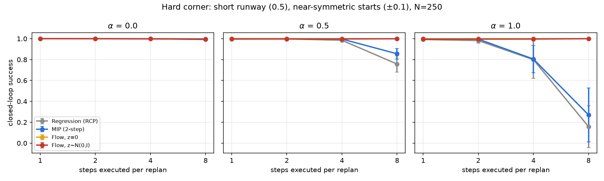
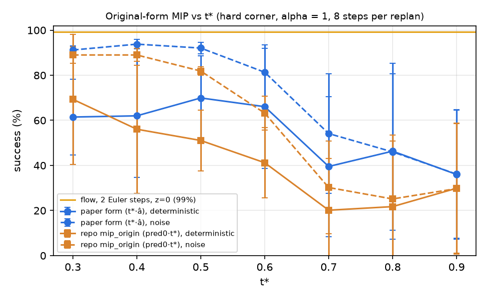
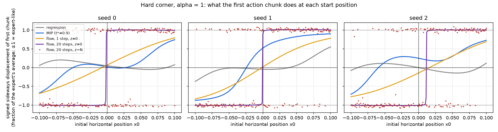
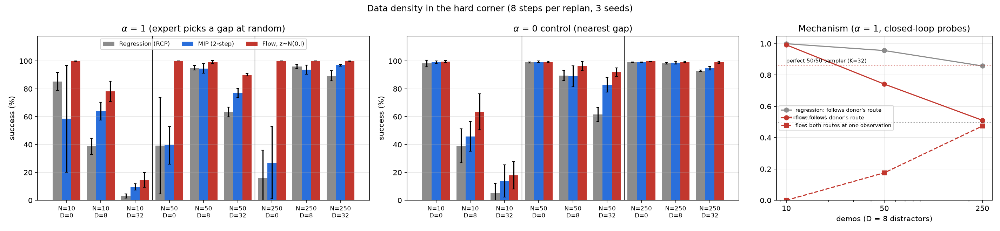

# Where MIP stops matching flow

A toy-scale follow-up to [Much Ado About Noising](https://arxiv.org/abs/2512.01809) (ICLR 2026).
A 2-D agent must pass a wall through one of two gaps; `alpha` sets how often the
expert picks the gap at random. Regression, MIP and flow are re-implemented from
the [official code](https://github.com/simchowitzlabpublic/much-ado-about-noising)
on a small MLP (3 seeds, 500 episodes each).



**Result.** In the default geometry, bimodal demos alone do not break regression
or MIP (94-100% success). They degrade with a short runway and near-symmetric
starts, and fail most with full ambiguity and the whole 8-step chunk run open
loop (e.g. at `alpha = 0.5` or with replanning every 4 steps they still drop to
76-86%):

| alpha = 1, replan every 8 steps | Regression | MIP | Flow (z=0) | Flow |
|---|---|---|---|---|
| success | 16% | 27% | 100% | 100% |
| same geometry, alpha = 0 | 99% | 99% | 100% | 100% |

Deterministic 2-step flow still gets 99%; MIP reaches 92% with t\* = 0.5 plus
noise. Policies that succeed commit their first chunk further towards one gap,
though not monotonically (one-step flow and MIP commit similarly but succeed
84% vs 36%). This does not
show that distribution learning is necessary: a deterministic policy that picks
a gap solves the task.

On the paper's datasets, the bimodality found by `multimodality.py` sits mostly
in the gripper command, not arm motion.

## Follow-up checks

Suggested by the paper's first author ([followup.py](followup.py)):

- **Original-form MIP** (`t* a + (1 - t*) z`): with a deterministic sampler it
  stays below flow at every tested t\* in 0.3-0.9 (best 70%); with noise added
  to the second-step input (not part of the official sampler) it reaches 94% at
  t\* = 0.4.
  
- **First-chunk displacement vs start position** (relative to the expert's
  average first-chunk displacement): one-step flow from z = 0 moves towards the
  side of the start at 98% of seed-position pairs (excluding |x0| <= 0.005),
  with a smooth ramp rather than the conditional mean; 20-step flow switches
  sharply near x0 = 0 (seed-dependent offset); regression moves much less and
  does not follow the side of the start (37%).
  
- **Data density** (`run_sweep.py --exp density`, [density_diag.py](density_diag.py)):
  hard corner with 10 / 50 / 250 demos and 0 / 8 / 32 per-episode distractor
  observation dims unrelated to the route. With 250 demos, 8 distractors raise
  regression from 16% to 96% and MIP from 27% to 94%; flow stays at 100% and the
  `alpha = 0` control at about 93% or above. Closed-loop probes from fixed
  observations: given another demo's distractors, regression follows that demo's
  route (0.86 vs 0.50 reference), i.e. it uses the distractors as a tie-breaker.
  Flow shows little such association with 250 demos and keeps both routes at a
  fixed observation, but moves the same way as demos get fewer (donor agreement
  0.51 / 0.74 / 0.99, fixed-observation route diversity 0.47 / 0.18 / 0 for
  250 / 50 / 10 demos; 0.86 is the expected score of a perfect 50/50 sampler).
  This is graded, not a switch: with 250 demos and 32 distractors flow does both.
  With 10 demos and distractors the control fails too, and with replanning every
  4 steps the success gap is much smaller (regression 80% to 97%).
  

## Run

```bash
pip install torch numpy pandas matplotlib h5py "zarr<3" scipy
python run_sweep.py --exp hard      # also: alpha_n, exec, commit
python run_fix.py                   # MIP t* and flow-step variants
python diag_commit.py               # first-chunk commitment
python followup.py sweep            # original-form MIP over t*
python followup.py chunk            # first-chunk displacement vs start position
python followup.py plot
python run_sweep.py --exp density --save_dir ckpt/density   # demos x distractors, saves models
python density_diag.py              # closed-loop probes on the saved models
python multimodality.py             # needs data/ from huggingface.co/datasets/ChaoyiPan/mip-dataset
python plot.py alpha_n exec commit hard density multimodality
```

Results used for the figures are in `results/`.
